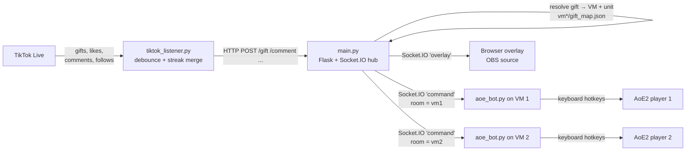

# TikTok Live × Age of Empires II

[](https://github.com/nikkibraiam/tiktok-live-aoe2/actions/workflows/ci.yml)

Turn a TikTok Live stream into an Age of Empires II battle: every gift, like or
comment from viewers trains real units inside two running AoE2 matches, and an
on-stream overlay shows who sent what.

## How it works



1. **Listener** (`tiktok_listener.py`) connects to a live stream with
   [TikTokLive](https://github.com/isaackogan/TikTokLive). Gift streaks are
   collapsed (only the final event counts) and events are buffered and flushed
   every 0.5 s, so a burst of 50 roses becomes one command instead of 50 requests.
2. **Hub** (`main.py`) maps each gift to a side and a unit using the per-VM
   config files, then pushes a `command` to the Socket.IO room of that VM and an
   `overlay` event to the browser source. Viewer avatars are fetched in a
   background task and cached.
3. **Bots** (`aoe_bot.py`) run inside each game VM, register to their room and
   translate `{action, unit, amount}` into AoE2 hotkeys with `pynput`
   (e.g. `Ctrl+B` → barracks, `S` → champion).
4. **Overlay** (`overlay/`) is a static page added to OBS as a browser source.

## Configuration

Each VM folder defines what viewers can trigger on that side:

```jsonc
// vm1/gift_map.json — gift name → building + unit hotkey
{ "gift": "Finger Heart", "army": { "action": "archery", "unit": "c" } }

// vm1/events_rules.json — likes threshold and comment keywords
{ "likes": { "threshold": 20, "army": { "action": "barracks", "unit": "s" } },
  "comment": { "arquero": { "action": "archery", "unit": "r" } } }
```

Environment variables:

| Variable | Used by | Default |
|---|---|---|
| `TIKTOK_USER` | listener | `nikkibraiam7` |
| `AOE_SERVER_URL` | listener, bots | `http://localhost:5000` |
| `AOE_BOT_NAME` | bots (`vm1` / `vm2`) | `vm1` |

## Running

```bash
pip install -r requirements.txt

python main.py               # hub on :5000, overlay at http://localhost:5000/overlay
python tiktok_listener.py    # while the stream is live

# inside each game VM, with AoE2 focused:
AOE_SERVER_URL=http://<host-ip>:5000 AOE_BOT_NAME=vm1 python aoe_bot.py
```

## Tests

```bash
pip install -r requirements.txt -r requirements-dev.txt
pytest
```

The hub is tested end to end with Flask-SocketIO's test client: gift routing to the right side, unknown gifts, per-user like thresholds and comment keywords. The listener tests cover streak handling, merging of repeated gifts and the payload sent to the hub. The keyboard bot is not tested: it needs a running game.

## Design notes

- **Debounce instead of per-event calls**: TikTok emits one event per gift in
  a streak; sending each one would flood the game with keystrokes. Buffering
  per `(user, gift)` keeps the input rate bounded.
- **Rooms per VM**: bots only receive commands for their side, so adding a
  third player is a new folder plus a new bot process.
- **Keyboard automation over memory hacking**: the bot only uses the game's
  own hotkeys, so it works with an unmodified client.

Licensed under MIT. Unit icons in `images/` belong to their respective owners (Age of Empires II:
Definitive Edition, Microsoft / World's Edge) and are used for a
non-commercial fan project.
